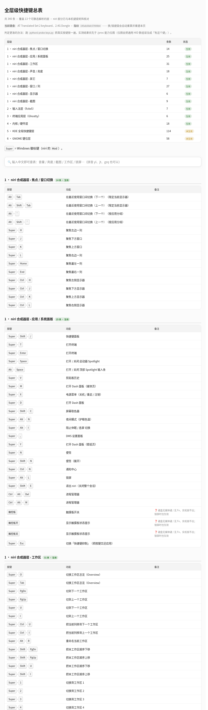

# 键位图鉴 · keymap-atlas

把一台 Linux 机器上**各层**的快捷键收集成中文速查表，并且回答一个大多数工具
回避的问题：**这个键，我这把键盘到底能不能按出来？**

[](examples/all-shortcuts-zh.md)

---

## 它解决什么问题

`/proc/bus/input/devices` 里每个键盘都有一张「按键能力位图」。看起来它是真相，
其实不是：很多 USB 键盘在 HID 描述符里只写一个**泛型全范围数组**
（键盘页 `0x00–0xff`、Consumer 页 `0x0–0x33c`），内核就把整段区间全标成「有这个键」。

后果很具体：
- 位图声称键盘有音量加减键，可你按下去什么都没发生；
- PrintScreen 在 evdev 里是 `KEY_SYSRQ(99)`，而 210 是 Consumer 接口声明的假象；
- 换一把键盘，所有「有/没有」的判断就该重算，但没人重算。

本项目把判断依据排成一条**优先级链**，每一级都能说清出处：

| 优先级 | 依据 | 结论 |
|---|---|---|
| 1 | 探针实测按出过 | ✅ 可按 |
| 2 | HID 描述符**点名**了该 usage | ✅ 可按 |
| 3 | 你标记「我这把键盘没有」 | ⛔ 按不出 |
| 4 | HID 描述符完全没覆盖 | ⛔ 按不出 |
| 5 | 只被泛型范围覆盖 | ❓ 存疑，需实测 |
| 6 | `/proc` 位图声称有 | ✅ 但注明「未实测」 |

## 六层快捷键

| 层 | 来源 | 本机实测 |
|---|---|---|
| 1 · niri 合成器层 | `~/.config/niri/**/*.kdl` | 137 条（生效） |
| 2 · 输入法层（fcitx5） | `~/.config/fcitx5/config` | 7 条 |
| 3 · 终端应用层（Ghostty） | `~/.config/ghostty/config` | 6 条 |
| 4 · 内核 / 硬件层 | logind 属性、`/proc/sys/kernel/sysrq` | 16 条 |
| 5 · KDE 全局快捷键层 | `~/.config/kglobalshortcutsrc` | 114 条（未生效） |
| 6 · GNOME 键位层 | `gsettings` | 58 条（未生效） |

还有一层**故意不列**：浏览器 / Electron 应用内快捷键、GTK-Qt 的 accel、键盘固件
里的 Fn 组合、`xdg-desktop-portal GlobalShortcuts`（按会话隔离，读别人的会话会被
`Access denied`）。这些只能说明原因，见报告最后一节。

## 安装

```bash
git clone https://github.com/Ayeez757/keymap-atlas
cd keymap-atlas
pip install --user .          # 只需要 Python ≥ 3.10，无第三方依赖
```

不想装也行，直接用源码跑：

```bash
PYTHONPATH=src python3 -m keymap_atlas report --outdir ~/快捷键
```

想用图形探针（真实按键检测）还要装 GTK4 的 Python 绑定：

```bash
# Fedora
sudo dnf install python3-gobject gtk4
# Debian / Ubuntu
sudo apt install python3-gi gir1.2-gtk-4.0
```

## 用法

```bash
keymap-atlas report              # 生成 md / html / tsv / json
keymap-atlas layers              # 这台机器能解析到哪些层、各多少条
keymap-atlas hid --keys          # 只读描述符：哪些键能从文件判定
keymap-atlas probe               # 开窗口按一遍真键（最准）
keymap-atlas lookup 音量         # 中文查
keymap-atlas lookup yl           # 拼音首字母
keymap-atlas lookup jt --all     # 连未生效的层一起
keymap-atlas doctor              # 自检证据源
```

产物里最重要的是 `all-shortcuts-zh.html`：单文件、离线、页内搜索框（按 `/` 聚焦，
Esc 清空，可以用 `#音量` 直接跳到某个词）。

### 弹窗速查（fuzzel）

```bash
scripts/keys-lookup.sh           # 弹搜索窗，选中即复制
scripts/keys-lookup.sh --cli 音量   # 不开窗，终端直出
```

### 换键盘自动重算

```bash
scripts/install-keymap-watch.sh   # 装成 systemd 用户服务
```

它用 `udevadm monitor --subsystem-match=input`（**不需要 root**）监听插拔，
指纹变了就重建；带 5 秒冷却与「落盘指纹必须等于当前指纹」的断言——
这条断言是 v0.1.0 修的 bug，旧脚本会因此一分钟弹 30 条通知。

## 为什么判定要分三态

因为「不确定」是真实存在的信息，抹平它会骗人：

- ✅ **可按**：实测按出，或描述符点名；
- ❓ **存疑**：只被泛型范围覆盖，文件层面无法判定 —— 请按一下；
  实测记录若属于上一把键盘，也会降级到这里；
- ⛔ **按不出**：描述符完全没覆盖，或你明确标记过。

## 兼容性

不绑定 niri。缺什么层就整层跳过，不会因为找不到文件崩掉：

- 合成器只支持 niri（其他合成器的键位在配置格式上完全不同，未实现）；
- 输入法 / 终端 / KDE / GNOME / 内核层是**独立探测**的，任意组合可用；
- 所有路径都能用环境变量覆盖：`KEYMAP_ATLAS_CONFIG_DIR`、`KEYMAP_ATLAS_OUT`、
  `KEYMAP_ATLAS_STATE`。

## 开发

```bash
PYTHONPATH=src python3 -m unittest discover -s tests -v
python3 -m compileall -q src/
```

139 个测试，覆盖设备矩阵解析、HID 描述符、证据优先级、KDL include 覆盖语义、
渲染产物（用标准库 `html.parser` 真解析一遍）、检索语义。

```
src/keymap_atlas/
  config.py     路径与「这台机器有什么」
  devices.py    /proc 设备矩阵、键盘识别、指纹
  hid.py        HID 描述符解析（item 编码、usage、范围）
  evidence.py   优先级链
  kdl.py        niri 配置解析与中文翻译
  layers/       六层，每层一个模块
  render.py     md / html / tsv / json
  lookup.py     检索与 fuzzel 弹窗
  probe.py      GTK4 实键探针
  cli.py        子命令
```

## 部署自己的副本

`web/` 是纯静态页面，`deploy/` 是 nginx 容器。想放到自己的域名上：

```bash
cd deploy && docker compose up -d
```

细节（证书、隧道、广告位怎么填）见 [docs/deploy.md](docs/deploy.md)。
那个文档里记了一个容易踩的坑：**隧道透传 TLS 时本地必须自己终结 TLS**。

## 许可

MIT。Copyright (c) 2026 Ayeez。
