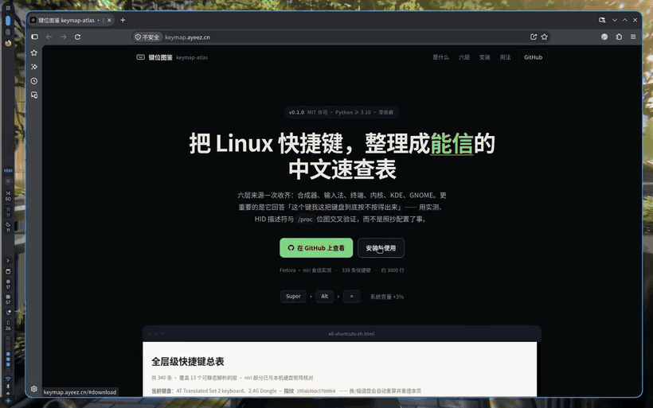

<div align="center">

# 键位图鉴 · keymap-atlas

**换键盘、换设备，照样上手。**

把一台 Linux 机器上散落在六处的快捷键收成一份中文速查表，
顺带回答一个大多数工具回避的问题：这个键，你这把键盘到底按不按得出来。

**[keymap.ayeez.cn](https://keymap.ayeez.cn/)** —— 在线版，直接搜，不用装。

[](https://www.python.org/)
[](LICENSE)
[](#兼容性)
[](#安装)

[官网](https://keymap.ayeez.cn/) · [设计说明](docs/design.md) · [层级说明](docs/layers.md) · [部署](docs/deploy.md)

<br>



</div>

---

快捷键真正的成本不是记不住，而是每次都重新找一遍。换一把键盘、换一台机器，
昨天还会的组合今天就得从配置文件里翻出来。而配置文件本身也不完全可信：
`/proc/bus/input/devices` 里每个键盘都有一张「按键能力位图」，看着像真相，其实经常是假的。

很多 USB 键盘在 HID 描述符里只写一个**泛型全范围数组**（键盘页 `0x00–0xff`、
Consumer 页 `0x0–0x33c`），内核就把整段区间全标成「有这个键」。后果很具体：
位图声称键盘有音量加减键，按下去什么都没发生；PrintScreen 在 evdev 里是
`KEY_SYSRQ(99)`，而 210 是 Consumer 接口声明的假象。

所以这个工具做两件事：把键位收齐，然后说清每一条**凭什么**可信。

## 它能做什么

- **六层一次收齐**：合成器、输入法、终端、内核、KDE、GNOME，缺哪层跳哪层
- **三种检索方式**：中文（`音量`）、拼音首字母（`yl`）、动作关键词（`截图`）
- **判定分三态**：可按 / 存疑 / 按不出，每一态都能追溯到证据
- **Fn 行也查得到**：亮度、音量、触摸板这类键由固件/ACPI 上报，单独列一组
- **实测优先**：想较真就开探针把键按一遍，实测结果压过任何文件推断
- **换键盘自动重算**：装成 systemd 用户服务，插拔后指纹变了才重建
- **产物可带走**：单文件 HTML，离线、页内搜索，拷到别的机器就能查

## 安装

```bash
git clone https://github.com/Ayeez757/keymap-atlas
cd keymap-atlas
pip install --user .
```

只需要 Python ≥ 3.10，没有第三方依赖。不想装也行：

```bash
PYTHONPATH=src python3 -m keymap_atlas report --outdir ~/快捷键
```

图形探针（可选的实键检测）需要 GTK4 的 Python 绑定：

```bash
sudo dnf install python3-gobject gtk4          # Fedora
sudo apt install python3-gi gir1.2-gtk-4.0     # Debian / Ubuntu
```

## 用法

```bash
keymap-atlas report            # 生成 md / html / tsv / json
keymap-atlas layers            # 这台机器能解析到哪些层、各多少条
keymap-atlas lookup 音量       # 中文查
keymap-atlas lookup yl         # 拼音首字母
keymap-atlas lookup 截图 --all # 连未生效的层一起查
keymap-atlas hid --keys        # 只读描述符：哪些键能从文件判定
keymap-atlas probe             # 开窗口按一遍真键（最准）
keymap-atlas doctor            # 自检证据源
```

产物里最有用的是 `all-shortcuts-zh.html`：单文件、离线，页内搜索按 `/` 聚焦，
Esc 清空，也可以直接 `#音量` 跳到某个词。

查表时想要弹窗而不是终端，用 fuzzel：

```bash
scripts/keys-lookup.sh              # 弹搜索窗，选中即复制
scripts/keys-lookup.sh --cli 音量   # 不开窗，终端直出
```

换键盘后自动重算：

```bash
scripts/install-keymap-watch.sh     # 装成 systemd 用户服务，不需要 root
```

它用 `udevadm monitor --subsystem-match=input` 监听插拔，等指纹稳定后
才重建，避免把插拔过程的中间态写进产物。

## 判定为什么分三态

因为「不确定」是真实存在的信息，抹平它会骗人。

| 优先级 | 依据 | 结论 |
|---|---|---|
| 1 | 探针实测按出过 | ✅ 可按 |
| 2 | HID 描述符点名了该 usage | ✅ 可按 |
| 3 | 你标记「我这把键盘没有」 | ⛔ 按不出 |
| 4 | 描述符有这一页、但没覆盖 | ⛔ 按不出 |
| 5 | 固件 / ACPI 接口上报它 | ✅ 可按（Fn 行） |
| 6 | 只被泛型范围覆盖 | ❓ 存疑，需实测 |
| 7 | `/proc` 位图声称有 | ✅ 但注明「未实测」 |

第 4 步只描述符**有这一页**时才成立。笔记本内置键盘常把键表交给 ACPI，
描述符里只有厂商页——那不是「一定按不出」，而是「文件层面看不出」，
落在第 6 步存疑。

实测记录属于上一把键盘时不会删除，而是降级为存疑；换回原键盘会自动重新生效。

## 六层快捷键

| 层 | 来源 | 一台真实机器上的条数 |
|---|---|---|
| 1 · 合成器层 | `~/.config/niri/**/*.kdl` | 137（生效） |
| 2 · 输入法层 | `~/.config/fcitx5/config` | 7（生效） |
| 3 · 终端应用层 | `~/.config/ghostty/config` | 6（生效） |
| 4 · 内核 / 硬件层 | logind 属性、`sysrq`、VT、Fn 行 | 28（生效） |
| 5 · KDE 全局快捷键 | `~/.config/kglobalshortcutsrc` | 114（未生效） |
| 6 · GNOME 键位 | `gsettings` | 58（未生效） |

还有一层是故意不列的：浏览器与 Electron 应用内快捷键、GTK-Qt 的 accel、
键盘固件里的 Fn 组合、`xdg-desktop-portal GlobalShortcuts`（按会话隔离）。
列不出来就在报告里说明原因，不假装支持。

## 兼容性

不绑定 niri。缺什么层就整层跳过，不会因为找不到文件而崩掉：

- 合成器目前只支持 niri。其他合成器配置格式完全不同，未实现；
- 输入法、终端、KDE、GNOME、内核层是独立探测的，任意组合可用；
- 路径都能用环境变量覆盖：`KEYMAP_ATLAS_CONFIG_DIR`、`KEYMAP_ATLAS_OUT`、`KEYMAP_ATLAS_STATE`。

## 开发

```bash
PYTHONPATH=src python3 -m unittest discover -s tests -v
python3 -m compileall -q src/
```

139 个测试，覆盖设备矩阵解析、HID 描述符、证据优先级、KDL include 覆盖语义、
渲染产物（用标准库 `html.parser` 真解析一遍）和检索语义。

```
src/keymap_atlas/
  config.py     路径与「这台机器有什么」
  devices.py    /proc 设备矩阵、键盘识别、指纹
  hid.py        HID 描述符解析（item 编码、usage、范围）
  evidence.py   优先级链
  kdl.py        niri 配置解析与中文翻译
  layers/       六层，每层一个模块
  render.py     md / html / tsv / json
  lookup.py     检索与 fuzzel 弹窗
  probe.py      GTK4 实键探针
  cli.py        子命令
```

新增一层就是新增一个 `layers/*.py`，附带测试即可。

## 部署自己的副本

`web/` 是纯静态页面，`deploy/` 是 nginx 容器：

```bash
cd deploy && docker compose up -d
```

证书与隧道怎么配见 [docs/deploy.md](docs/deploy.md)。那里记了一个容易踩的坑：
隧道只透传 TLS 时，本地必须自己终结 TLS。

## 许可

MIT。Copyright (c) 2026 Ayeez。
